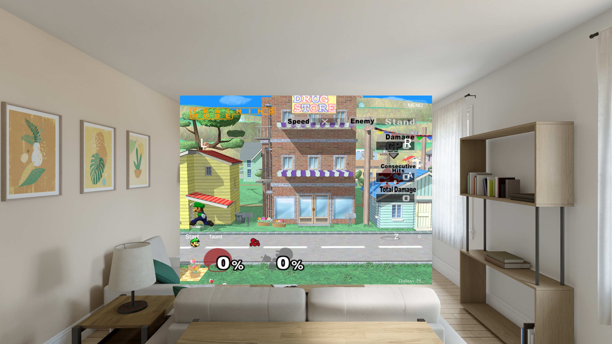

# AR Mode: mixed-reality Melee on Apple Vision Pro

[xelee](https://github.com/rhythmerc/xelee) plays Super Smash Bros. Melee inside your room on a
Meta Quest 3: the game screen floats in space, you place it (and, in xelee's full form, the whole
3D arena) with your hands, menus follow a laser pointer, and sound comes from where the fighters
are. This document studies that experience and describes Dashdance's **AR Mode** on Apple Vision
Pro. Dashdance currently implements the floating-screen presentation: the game and its Slippi
online stack are unchanged, and the finished game picture is placed in an immersive space.
Xelee's full 3D arena is a separate, unimplemented phase (§4).

Part 1 documents how xelee works (from its code and docs). Part 2 documents the Vision Pro
platform research. Part 3 is the design and as-built state of Dashdance's implementation.

## Contents

1. [How xelee works](#1-how-xelee-works)
2. [Vision Pro platform research](#2-vision-pro-platform-research)
3. [Dashdance's AR Mode](#3-dashdances-ar-mode)
4. [Phase 2 plan: the 3D arena](#4-phase-2-plan-the-3d-arena)
5. [References](#5-references)

---

## 1. How xelee works

Xelee is built on the same foundations as Dashdance: the doldecomp Melee decompilation translated
to native code (`src/melee`, `src/sysdolphin`), the [aurora](https://github.com/encounter/aurora)
GameCube SDK/GX layer, and a Slippi online stack. On top it adds a mixed-reality layer that is
cleanly split in two:

- **Game-side logic, platform-agnostic** (~6,600 lines in `src/pc/xr_scene.c`, `xr_place.c`,
  `xr_pointer.c`, `spatial_audio.c`, `stage_mix.c`, `stage_ambience.c`). It knows nothing about
  Quest or OpenXR; it emits draw categories, transforms and events through ~40 `aurora_xr_*`
  entry points.
- **The XR renderer** (in xelee's aurora fork, `lib/xr/xr.cpp`, an OpenXR + Dawn/WebGPU
  implementation — Quest-specific and not portable).

### 1.1 The two presentation paths

**The virtual screen** (menus and everything non-fight): the game renders exactly as the flat
build; the finished frame is presented as a quad floating in the room — 0.7 m wide, 0.85 m in
front of the starting head position, always turning to face the head. This path needs nothing
from the game.

**The 3D arena** (fights): xelee's signature. A world vertex reaches an eye as

```
clip_eye = P_eye · V_eye · A · X · V_game⁻¹ · M_pos · v
```

- `M_pos` — the GX position matrix of the draw (model → game camera space). Lighting, skinning,
  texgen and projected shadows all happen before projection, so they replay unchanged.
- `V_game⁻¹` — undoes the fight camera; captured per frame from the fight camera object
  (`cm/camera.c`, the `HSD_CObj` view matrix).
- `A = T(pos) · R_y(yaw) · S(scale)` — the arena placement, applied about a per-stage center
  point in game units (scale = a base meters-per-unit × a per-stage factor; yaw only, never
  pitch/roll).
- `X` — per-moving-piece extra transform for the few stages whose pieces should move in the room.
- `P_eye · V_eye` — the headset's per-eye view/projection in metres.

Draws are tagged by which game camera drew them (world / HUD / mono) via hooks in the game code
(`cm/camera.c`, `if/ifall.c`), and the world draws are re-rendered per eye from the same command
stream ("replay") while the flat frame keeps feeding 2D uses (Pokémon Stadium's screen, EFB
copies). Alpha is depth coverage: pixels the world geometry covers hide the room; translucent
draws add light on top. The HUD is replayed onto its own quad hovering above the stage.

### 1.2 Placement (the "stage spot")

Placement is a pose `T · R_y · S` with a resolution order: this stage's session grab → the
adopted base × stage factor → a default in front of where the head is looking. Gestures (one
hand: pinch-drag; two hands: spread = scale, twist = yaw) are resolved against a plane and an
anchor stores the adopted spot so it survives relaunches. Before each fight the game holds
(no simulation ticks, pads flushed) until the player confirms with A; a dedicated dummy scene
("Place Stage") runs the same flow against a practice stage.

### 1.3 Pointer menus

A ray from the controller tip (or estimated from the hand) intersects the screen quad → 0..1
coords → logical pixels (640×480-ish) → merged into port 1's virtual pad. Menus cooperate: each
menu projects its option boxes through the menu camera (`HSD_CObj` clip matrix) so the pointer
"snap follows" selectable items; a click arms the A press. Grips/triggers don't press Z/L/R
while the laser is on the screen.

### 1.4 Room sensing

- Floor/grounding: a worker casts a grid of downward rays into the room mesh; a contact shadow
  quad (alpha ∝ coverage · R²/(R²+h²), an ambient-occlusion law) is composited between
  passthrough and content so the screen/arena appears to sit on the real floor.
- Anchors persist the adopted spot; a boundary/passthrough layer switch separates MR from VR.
- Room lighting (experimental): a passthrough camera feed feeds a radiance cube → key/fill
  lights + SH ambient applied to the eye-pass shaders, plus a per-stage "grade" tint on
  passthrough. (Built, then removed as shipped feature.)

### 1.5 Spatial audio

Steam Audio binaural pipeline: emitters are tracked through the game object system
(`gobj` procs), voices are tagged at the AX driver level, positions are published once per
drawn frame from the fight camera, and a 5 ms render mixes each voice through distance gain and
an HRTF into a positional bus. The crowd is a ring of six decorrelated seats; music stays
mostly stereo with a virtual speaker pair; synthesized stage ambience (waterfalls, wind,
Doppler on Big Blue) feeds the same buses. Fully output-only — netplay and rollback untouched.

### 1.6 Frame pacing

Display at 120 Hz, game tick every second display frame (lock-step via the VI retrace), a
fixed-latency release slot per frame, Application SpaceWarp (motion-vector reprojection to an
apparent 120 Hz), and deadline-driven dynamic resolution. The relevant takeaway for Vision Pro:
**eyes re-rendered every display frame from the newest game frame** is the portable pattern.

---

## 2. Vision Pro platform research

What follows is the condensed API map from Apple's documentation and CompositorServices
samples. The implementation's API spellings were checked against the installed Xcode 27
visionOS SDK in October 2026; runtime evidence is listed separately in §3.5.

### 2.1 The compositing model

Vision Pro composites every app's windows and spaces itself. To draw at display rate with your
own Metal engine you use **Compositor Services**: an `ImmersiveSpace` whose content is a
`CompositorLayer` hands you a `LayerRenderer`, and you render directly into its per-frame
textures — bypassing the render server. The system still owns passthrough and everything else.

- In the **mixed** immersion style, your layer's alpha blends with the real room: clear alpha 0
  shows passthrough. This is exactly the mixed-reality canvas xelee gets from OpenXR +
  passthrough layers.
- `upperLimbVisibility(_:)` chooses whether hands appear in front of your content.

### 2.2 The frame protocol (LayerRenderer)

```
while layerRenderer.state != .invalidated {
  if paused { layerRenderer.waitUntilRunning(); continue }
  let frame = layerRenderer.queryNextFrame()          // if nil, briefly yield and retry
  frame.startUpdate()                                  // update phase: simulate, animate
  let timing = frame.predictTiming()                   // predicted deadlines
  ... update scene (no head-dependent work) ...
  frame.endUpdate()
  LayerRenderer.Clock().sleep(until: timing.optimalInputTime)   // pace
  frame.startSubmission()
  let drawable = frame.queryDrawable()                 // 1 (or more, e.g. during capture)
  // per drawable:
  let t = Clock.Instant.epoch.duration(to: drawable.frameTiming.presentationTime).timeInterval
  drawable.deviceAnchor = worldTracking.queryDeviceAnchor(atTimestamp: t)   // predicted head pose
  ... encode Metal ...
  drawable.encodePresent(commandBuffer:)               // presentation event
  commandBuffer.commit()
  frame.endSubmission()
}
```

Rendering details:

- Textures: `drawable.colorTextures[0]` / `depthTextures[0]`; with the default (layered) layout
  this is a **texture array with one slice per eye**; `drawable.views` holds one `View` per eye
  with `transform` (eye→device) and a texture-map viewport. Apply the drawable's rasterization
  rate map to the render pass when foveation is enabled.
- A single render pass draws both eyes (`renderTargetArrayLength = drawable.views.count`) with
  **vertex amplification** (`setVertexAmplificationCount`); the vertex shader picks per-eye data
  via `[[amplification_id]]`. Dedicated textures require each pass to use its own eye's matrix,
  texture index and slice.
- Per-eye matrices: `viewMatrix = (deviceAnchor.originFromAnchorTransform * view.transform).inverse`,
  `projection = drawable.computeProjection(convention: .rightUpBack, viewIndex:)`.
- Dashdance configures HDR `rgba16Float` output and reverse-Z depth. Foveation and layout are
  adjustable through `CompositorLayerConfiguration`. Its shader composites the game's 8-bit
  display-space textures before converting the result to linear light for the HDR target.
- The layer runs on the app's own thread (`Task { @RendererActor ... }`); the system pauses/
  invalidates it as the space opens and closes.

### 2.3 Input: system spatial events

A fully custom Metal layer gets no UIKit/RealityKit gestures, but the system's **look + pinch**
still works: `layerRenderer.onSpatialEvent` delivers a `SpatialEventCollection` on the main
thread — each event has an `id`, a `phase` (`.active`/`.ended`/`.cancelled`), a location, and
optional `inputDevicePose` and `selectionRay` values. The selection ray locates the intended
target; the physical hand position supplies placement movement. End/cancel events must still
release input when the hand pose is absent. Multiple active events allow two-handed gestures
without an ARKit hand-skeleton provider. Simulator controls are described in Apple's
[Device Hub guide](https://developer.apple.com/documentation/xcode/interacting-with-your-visionos-app-in-device-hub);
their availability does not establish that Dashdance's gesture mapping has passed testing.

### 2.4 World tracking and persistence

`ARKitSession` runs providers:

- `WorldTrackingProvider` — predicted device pose (`queryDeviceAnchor(atTimestamp:)`, the one
  call the render loop cannot skip) and **world anchors**. `WorldAnchor` UUIDs *and transforms
  persist across multiple runs of your app* (Apple's documented behaviour); `allAnchors` returns
  the known ones on launch. This is the Vision Pro equivalent of xelee's persistent stage spot.
- Authorizations: `ARKitSession.requestAuthorization(for: WorldTrackingProvider.requiredAuthorizations)`
  (world sensing) before anchoring; `HandTrackingProvider` would additionally need hand-tracking
  authorization (not needed for phase 1 — spatial events cover the gestures).
- `PlaneDetectionProvider` / `SceneReconstructionProvider` (room mesh) exist for grounding
  (phase 2: contact shadows).

Info.plist keys for device builds: `NSWorldSensingUsageDescription` (and
`NSHandsTrackingUsageDescription` when hand tracking is adopted).

### 2.5 Simulator support

Xcode 27 presents the visionOS Simulator in **Device Hub**, including a synthetic room and
camera controls. This is sufficient to inspect Dashdance's floating game screen; the current
evidence includes actual Training gameplay there. Camera movement, spatial input and anchor
persistence require their own checks. A visible simulator screenshot does not verify stereo
comfort, headset tracking, real hands or room-anchor behavior on a Vision Pro.

### 2.6 Mapping xelee → Vision Pro

| xelee (Quest / OpenXR) | Vision Pro equivalent |
|---|---|
| OpenXR session + swapchains | `ImmersiveSpace` + `CompositorLayer` + `LayerRenderer` |
| Passthrough composition layer | System passthrough in the **mixed** immersion style (alpha blends) |
| Composition quad layers (screen, HUD, lasers) | Rendered in-eye into the layer (Vision Pro has no app-owned compositor quads) |
| Controller/hand pose → laser ray | `onSpatialEvent` selection rays (system look+pinch) |
| `XR_META_environment_raycast` floor + AO shadow | (phase 2) `PlaneDetectionProvider` / `SceneReconstructionProvider` |
| `XR_FB_spatial_entity` anchor persistence | `WorldAnchor` (persists across launches by contract) |
| SpaceWarp / ASW to 120 Hz | Not available; eyes re-render every display frame (90/100 Hz) from the newest 60 Hz game frame |
| Deadline-driven dynamic resolution | `LayerRenderer` paces; internal EFB scale caps already exist (`metal_scale_caps`) |
| Separate 2D panel activity | visionOS supports app windows beside a space; Dashdance dismisses its main window during AR and restores the game window when AR closes |

### 2.7 Porting notes: what changes between Quest and Vision Pro

From Apple's guidance for Metal games on visionOS (WWDC24 10092, "Render Metal with passthrough",
the HIG for immersive experiences) and the compositor documentation of both platforms:

- **The compositor owns reprojection on both platforms, differently.** Quest's TimeWarp/ASW
  reprojects the app's eye buffers (and can synthesize frames from motion vectors); Vision Pro's
  render server reprojects your `LayerRenderer` frames against the predicted `deviceAnchor` and
  dims content near real objects in mixed immersion. The app-side consequence is the same: match
  the predicted pose, never lag it. There is no ASW on Vision Pro — the pattern is eyes re-rendered
  every display frame from the newest game state, with the game simulation decoupled (which is what
  the mirror, producer event and frame-lease design does).
- **No app-owned compositor layers.** Quest apps compose quad layers (screen, HUD, lasers) on top
  of passthrough; on Vision Pro everything is rendered in-eye into the one immersive layer. AR
  Mode therefore composites the in-game menu and the touch controls itself, in its own shader.
- **Windows and spaces are system-managed.** App windows can coexist with a mixed immersive
  space. Dashdance dismisses its main window while the quad is the display and requests its
  recreation after the space closes. Space open/dismiss is asynchronous; only one
  immersive space per app; `UIApplicationSupportsMultipleScenes` must be true (this bit us —
  see §3.3).
- **Input differs more than rendering.** Quest ships controllers with laser rays; Vision Pro has
  none — the system ray is your eyes, and gestures are look+pinch. Ports either drive a virtual
  cursor from the pinch (xelee's laser) or map the game's own touch controls onto the screen.
  AR Mode does the latter: the quad carries Dashdance's touch layout and pinches become fingers
  (see §3.1). This is the intended controller-free input path; actual pinch-driven play remains
  unverified. The existing gamepad input path also remains available.
- **Anchors: Meta's persistence API vs ARKit's built-in contract.** Quest needs
  `XR_FB_spatial_entity` + a storage layer; visionOS `WorldAnchor` UUIDs and transforms persist
  across launches by contract, and `allAnchors` returns them on launch.
- **Passthrough is a system service.** No layer styling/color-grading hooks like
  `XR_FB_passthrough` styling; what you get is the mixed style, system dimming near objects, and
  (visionOS 26) tint effects on the space — AR Mode keeps the passthrough untouched.
- **Comfort rules are documented, not suggestions.** Content within the field of view, indirect
  gestures, no required head movement, and a stationary frame of reference — a placed screen that
  stays put (and is remembered) is exactly the recommended shape.

---

## 3. Dashdance's AR Mode



### 3.1 What it is

After Play, AR Mode opens an immersive space and presents the finished game picture on a
floating screen in the room. This includes fights and Training: the stage and fighters remain
inside that picture. The screen has a position and orientation in space; the game itself is
not re-rendered as a 3D arena around the player.

The main SwiftUI window is dismissed and the flat SDL window is hidden while AR is open.
Closing AR requests a new main scene and reattaches the existing SDL game window to it. The
game and Metal layer are retained, and a one-time launch guard prevents another simulation
thread from starting when the root view reappears. This recovery path is implemented but
still needs the runtime checks listed in §3.5.

The implemented gesture mapping intersects the system selection ray with the screen. A pinch
on the picture feeds Dashdance's touch controls and in-game menu. A pinch outside it starts
placement: one hand moves the screen in three dimensions; two hands change its yaw and width.
Releasing placement saves a rigid world-anchor pose and stores the screen width separately.
The renderer releases active touches on cancellation, pause and closure. These mappings and
cross-launch persistence are implemented, but controller-free play has not yet been verified.

This is xelee's **virtual screen path** (§1.1), with separate work still needed for the
3D arena in §4.

### 3.2 How a frame reaches the quad

The game renders into its intermediate EFB texture. While the immersive space is open, the
Metal backend skips flat presentation and runs `render_mr` at each XFB copy. It writes the
game picture and a separate premultiplied touch/menu/HUD overlay into a three-slot ring. Slot
`sequence % 3` belongs to the published mirror sequence; this sequence advances only when a
mirror frame is published, independently of the game's frame counter.

The producer signals an `MTLSharedEvent` named `done` after encoding the mirror passes. A
successful `dashdance_ar_snapshot` acquires a frame lease that retains the latest picture,
overlay and event. Swift waits for `done` on its GPU command buffer before sampling them,
then releases the lease from the command buffer's completion handler. Early exits release
the lease immediately. Every acquisition has its own lease, including repeated display-rate
reads of the same game frame.

Before reusing a ring slot, the producer checks for leases on that slot. If it is still in
use, it skips that mirror publish instead of waiting for the consumer. Resizing replaces the
ring while existing leases keep old textures alive. There is no consumer `read` event and
no GPU wait on a consumer acknowledgment in the game's command stream.

Presentation aspect comes from the player's 4:3/16:9 setting rather than the EFB's pixel ratio.
Touch and menu geometry use the displayed aspect, while texture sampling maps that logical
surface onto the ring. The AR path runs the requested MetalFX pass itself, including the Auto
scale case, because flat presentation is skipped; without MetalFX it applies the configured
sharpening. These code paths exist, but 16:9 and the image-quality variants still need visual
acceptance checks.

The quad composites the picture and overlay in the same display-color space as the flat path,
then converts the result to linear light for the `rgba16Float` compositor target. Its pipeline
binds a sampler, writes reverse-Z depth, uses the drawable's foveation maps, and selects the
correct eye matrix and texture in both layered and dedicated layouts. When the compositor
has no frame available, the render task yields briefly instead of spinning.

### 3.3 Where things live

| File | Role |
|---|---|
| `port/runtime/gx/ar_bridge.h` | The C ABI shared by the game, Metal and Swift: frame snapshots/leases, lease release, touch events and app-flow hooks |
| `port/runtime/gx/gx_metal.{h,mm}` | `MetalOptions::ar_mirror`; ring ownership, producer event, display aspect, MetalFX/sharpening and snapshot acquisition/release |
| `port/runtime/host/game_menu.cpp` | Per-surface menu geometry (`menu_overlay`/`menu_touch(..., surface)`: 0 = flat window, 1 = the quad) |
| `port/runtime/host/window_sdl.cpp` | The quad's independent touch/menu surface in displayed-aspect coordinates, merged into port 1; main-thread window visibility and notification of the native SDL window |
| `port/app/main_mac.cpp` | AR options and space-open request; the game phase transition, one-time game-thread launch and window-restoration entry point |
| `port/app/visionos/bridge.h/.c` | Space/dashboard hooks and the native-window notification shared with Swift |
| `port/app/visionos/DashdanceVisionApp.swift` | SwiftUI app lifecycle, dashboard/game phases, saved open-window action, and a UIKit scene marker that reattaches the existing SDL window to the recreated main scene |
| `port/app/visionos/ARScreenRenderer.swift` | The `LayerRenderer` loop, quad shaders, play-vs-place gesture classification, world-anchor persistence |
| `port/CMakeLists.txt` | visionOS: compiles the Swift sources with `swiftc -emit-library -static`, links SwiftUI/CompositorServices/ARKit/`_CompositorServices_SwiftUI` |
| `port/app/ios/Info.plist.in` | `UIApplicationSupportsMultipleScenes` (required to open a space beside the window), `NSWorldSensingUsageDescription`, `NSHandsTrackingUsageDescription` |
| `port/scripts/ar_training_acceptance.txt` | Scene-gated input sequence that reaches actual Training gameplay (`major=0x1C`, `minor=0x02`) |
| `setup.sh` | Builds the chosen platform, selects a matching booted simulator and honors `--udid` for installation and launch |

Three SDK notes for whoever touches the Swift next: in the current Xcode the SwiftUI surface of
CompositorServices lives in the `_CompositorServices_SwiftUI` module (`CompositorLayer` there is
an `ImmersiveSpaceContent`, not a `View`, and `LayerRenderer.onSpatialEvent` hangs off it), the
Metal importer renames several APIs (`rgba8Unorm_srgb`, `makeTextureView(pixelFormat:)`,
`encodeWaitForEvent(_:value:)`, `drawPrimitives(type:...)`), and the MSL vertex-amplification
attribute is `[[amplification_id]]`. The deployment target is visionOS 2.0.

Also fixed on the way: three iPhone Duo code paths (`UIViewReservedRegion`,
`UIHingeInteraction`) that the visionOS SDK does not declare are now compiled out there
(`ios_launcher.mm`, `window_fold_apple.mm`) — the visionOS build had been broken since the Duo
work landed.

### 3.4 Running it

```bash
export DEVELOPER_DIR=/Applications/Xcode.app/Contents/Developer
VISION_SIM_UDID="the-booted-visionos-simulator-uuid"
./setup.sh /path/to/melee.iso --visionos --udid "$VISION_SIM_UDID"
SIMCTL_CHILD_MELEE_AR=1 xcrun simctl launch "$VISION_SIM_UDID" app.dashdance.ios
```

In the app, the dashboard's **Display & Performance** card has an **AR Mode (play in the room)**
switch — flip it on and press Play; the choice is remembered in `launcher.ini` (`ar=`). Open
the selected Vision Pro simulator in Xcode 27's Device Hub to inspect its room view. Follow
the installed Device Hub controls for camera movement and simulated interaction. Multi-hand
interaction remains unverified.

`port/scripts/ar_training_acceptance.txt` drives the game into Training, with scene gates for
the character-select screen, stage select and the running match. Its gameplay target is
`major=0x1C`, `minor=0x02` (`--expect-scene 0x021c`). Scripted input and `MELEE_PAD_FILE` take
precedence over normal controller/touch input, so remove those overrides when testing actual
pinches or a gamepad. Reaching Training with a script does not verify spatial controls.

For a **real Vision Pro**:

```bash
./setup.sh /path/to/melee.iso --visionos-device --team auto   # signed, installed over USB, launched
```

Developer Mode must be on; the disc goes into the app's folder in Files; flip AR Mode on in the
dashboard and press Play. `MELEE_AR=1` / `--ar` remain as env/flag overrides for scripted runs.

### 3.5 Verification status

Evidence recorded on **22 October 2026**, using Xcode 27 and the **visionOS 27 Simulator**
(`xrsimulator`, Apple-Vision-Pro-4K). These results describe observed sessions; a source fix
or successful build does not by itself establish that a behavior passed.

| Check | Evidence / current status |
|---|---|
| Actual 4:3 Training gameplay in AR | **Observed.** The acceptance script and an external pad-file driver reached `major=0x1C`, `minor=0x02`; live gameplay appeared on the floating screen in the simulated room. |
| Screenshot | Native simulator capture: [`AR_TRAINING_VISION_PRO.jpg`](screenshots/AR_TRAINING_VISION_PRO.jpg). This is a running Training session, not a menu or a mockup. |
| Metal validation during gameplay | **No validation errors observed in the tested gameplay session.** That session crashed on quit in power-management teardown; a main-thread fix has been made but its rerun is pending. This is not a clean-exit pass. |
| Spatial pinch controls and placement | **Not verified.** Selection-ray hit testing, cancellation handling and hand-based movement are implemented; menu selection, stick/buttons, move, yaw and two-hand scale still need interaction tests. |
| Camera movement and screen anchoring | **Not verified.** A front-facing room capture does not demonstrate parallax, head tracking or a stable placement under camera movement. |
| 16:9 and image-quality settings | **Not verified visually.** Display-aspect geometry and the AR MetalFX/sharpening paths are implemented. |
| Closing AR and restoring the flat game window | **Not verified after the scene-binding changes.** Test ordinary closure and interruption/reopen without starting another game thread or losing the window. |
| Anchor restore and recentering | **Not verified.** The renderer stores a rigid anchor and width, but does not currently consume `anchorUpdates`; Digital Crown recentering or world-origin corrections therefore need additional work and testing. |
| Per-eye rendering and foveation on hardware | **Not verified on a device.** API checks and a simulator picture do not establish stereo or headset behavior. |
| Performance and other platforms | No zero-late-frame, latency or current-diff macOS/iOS regression result is claimed here. Measure those separately from builds and simulator tooling. |

**No Vision Pro hardware validation has been completed.** Device testing still needs real
look-and-pinch input, two-hand placement, comfort, tracking, authorization and persistence.
Apple's [world-tracking guidance](https://developer.apple.com/documentation/visionos/tracking-points-in-world-space)
explains that recentering changes anchor coordinates and that apps should process anchor updates.

---

## 4. Phase 2 plan: the 3D arena

The full xelee experience — the stage and fighters rendered as 3D geometry in the room — is
planned but not built. Training currently uses the same floating 2D screen as every other
game scene. The missing pieces include draw categorization and camera capture (§1.1):

1. **Capture the fight camera.** xelee hooks `cm/camera.c`. Dashdance doesn't modify game code,
   but it doesn't need to: the fight camera's view matrix lives in guest RAM at an address the
   pinned decomp's map file names. A per-frame guest-memory read (the same mechanism as the
   existing watchpoints) yields `V_game` without touching the recompilation.
2. **Tag draws.** `gx::Frame` already stamps `scene_major/scene_minor` per frame, and every
   `DrawCall` carries its full XF matrix state. Two viable taggers, in order of preference:
   - compare each draw's view matrix (XF regs) against the captured fight camera — matches are
     world draws, everything else (HUD, menus, transitions) renders flat; heuristic, zero game
     patches;
   - or hook the camera-category calls through `port/recomp/hle_list.txt` (symbol replacement),
     the xelee-faithful route.
3. **Re-project.** The Metal backend renders world draws with `view_proj = P_eye·V_eye·A·V_game⁻¹`
   (one per eye, layered/amplified) instead of the game's projection — the same matrix override
   plumbing the sub-frame presenter already has (`submit_frame(frame, overrides)`), extended
   from per-draw position matrices to the view/projection.
4. **Stage placement.** Adopt xelee's `T · R_y · S` about a per-stage center in game units, with
   the placement-hold state machine ported from `xr_place.c` (game-side logic, portable).
5. **Grounding.** `PlaneDetectionProvider` gives the floor height for a contact-shadow quad
   under the arena (xelee's AO law), replacing `XR_META_environment_raycast`.
6. **Spatial audio.** Dashdance's audio path is SDL; the xelee pipeline (emitter tracking →
   voice tagging → per-frame positions → HRTF) is portable, and on visionOS the listener comes
   from `queryDeviceAnchor`. Scope it separately from the rendering work.

---

## 5. References

- xelee: <https://github.com/rhythmerc/xelee> — `docs/quest-xr.md` (the master XR document),
  `docs/xr-stage-placement-ux.md` §A.1 (placement transforms), `src/pc/xr_scene.c` (staging).
- Compositor Services: [Drawing fully immersive content using Metal](https://developer.apple.com/documentation/compositorservices/drawing-fully-immersive-content-using-metal);
  sample [Interacting with virtual content blended with passthrough](https://developer.apple.com/documentation/compositorservices/interacting-with-virtual-content-blended-with-passthrough)
  (associated with WWDC24 10092, "Render Metal with passthrough in visionOS").
- ARKit (visionOS): `ARKitSession`, `WorldTrackingProvider`, `WorldAnchor` (persistence),
  `HandTrackingProvider`; [Tracking specific points in world space](https://developer.apple.com/documentation/visionos/tracking-points-in-world-space).
- Simulator: [Interacting with your visionOS app in Device Hub](https://developer.apple.com/documentation/xcode/interacting-with-your-visionos-app-in-device-hub).
- Porting patterns: [Bring your iOS or iPadOS game to visionOS](https://developer.apple.com/videos/play/wwdc2024/10093/)
  (WWDC24 10093 — windowed Metal games, stereoscopy and head tracking); Apple's
  [Immersive experiences](https://developer.apple.com/design/human-interface-guidelines/immersive-experiences)
  Human Interface Guidelines.
- Meta compositor references (TimeWarp/Application SpaceWarp) for the ASW comparison in §2.7.
